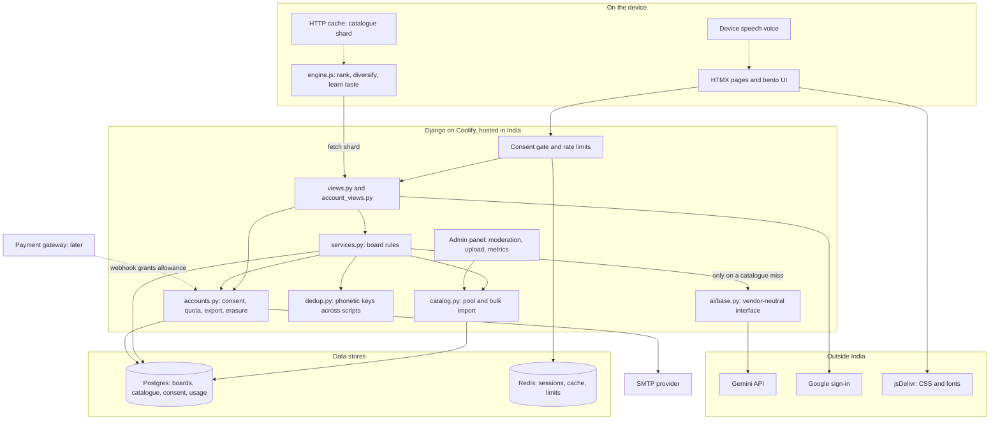
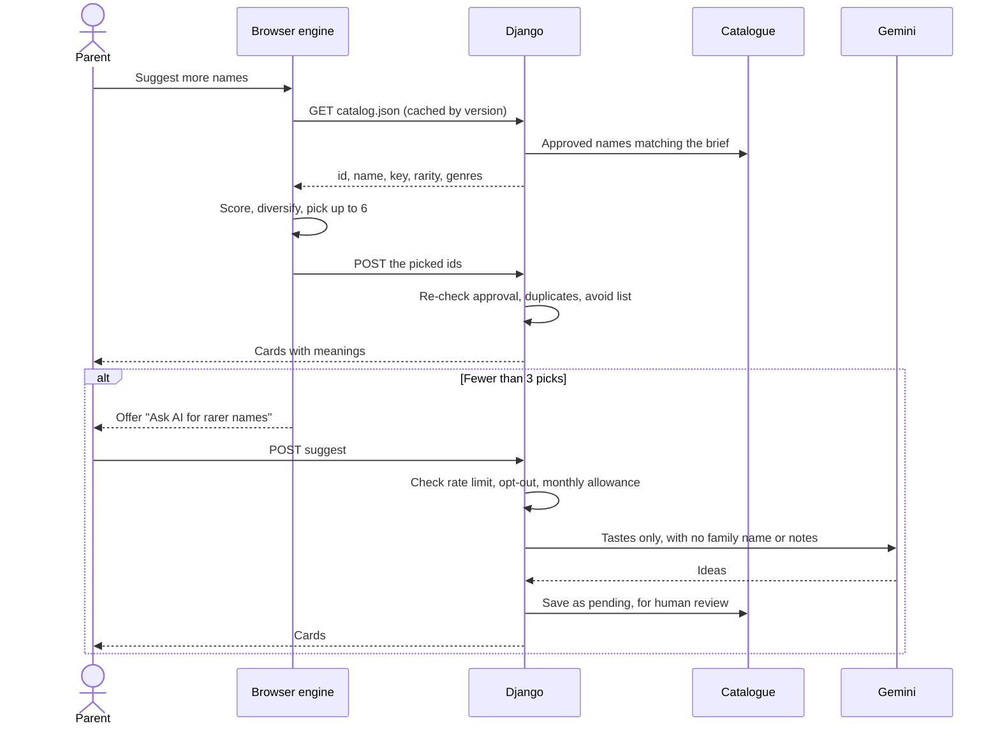
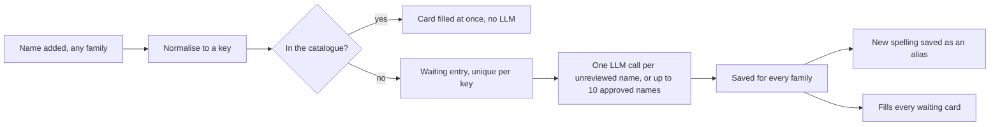

# Architecture

A server-rendered Django monolith with HTMX. The browser ranks names. The server owns state, permissions and money. The LLM is the last resort.

## How a suggestion gets made

## Background work

Nothing talks to a third party while a person waits, except the Google sign-in callback, which has to finish before the page can load. Jobs are rows in the database and run on thread pools inside each web process (`names/jobs.py`). Email and LLM have separate pools, so a slow LLM call can't delay a sign-in code.

| Work | Person sees | Then |
|---|---|---|
| Sign-up or reset email | The next page at once | Sent, with up to 5 tries. The row is deleted on success |
| Tags and meaning for a name | The card at once, with details filling in | Polls every 2 seconds |
| "Ask AI" | Keeps swiping | Cards join the deck when ready |
| Family ideas | Catalogue ideas at once | LLM ideas join them |
| Natural voice | Device voice is instant; this shows "Preparing…" | Plays when ready |

## How insights are cached and batched

Because the waiting entry is unique per key, a thousand parents asking about one new name cause one lookup. Only that name is sent, and text that doesn't look like a name is refused at the form, so answers are safe to share. Names no person has approved never share a prompt, so one family's text can't steer the answer about another's name.

Suggestions are different, because a family's own description shapes them. Their text only reaches that family. The names they return wait in the catalogue for review, and until an admin approves one, another family asking about it gets a fresh answer of its own.

## How names are normalised

1. **Rules:** `dedup.phonetic_key` handles Unicode forms, invisible joiners, nine Indic scripts, Urdu and Latin spelling folds.
2. **Learned aliases:** `catalog.canonical_key` follows spellings the LLM or admins have linked to an entry.
3. **Close matches:** `dedup.find_duplicate` uses spelling distance and consonant outlines. These only ever ask the person.

What someone typed is kept. A name typed in a script gets its Latin spelling once known, with the typed form as its native spelling.

## Where each thing runs

| Concern | Runs on | Why |
|---|---|---|
| Ranking, diversity, taste | Device | Free and instant, and a wrong answer costs nothing |
| Pronunciation | Device first | Free. The paid voice is a fallback, cached once per name for everyone |
| Catalogue filtering | Server | Limits how much of the catalogue one person can download |
| Duplicate checks on writes | Server | The one implementation handles Indian scripts, and a client can't be trusted to enforce it |
| Permissions, quotas, consent, payment state | Server | Anything on a device can be edited by its owner |
| Family boards | Server | Several people share them |

## Cost guards on the LLM

1. The catalogue and browser answer first.
2. People choose to spend a request, except when a new board has no matches at all.
3. Answers are cached by phonetic key, so a name is only described or voiced once across all families.
4. Paid answers join the moderation queue and can serve other families for free once approved.
5. A monthly allowance per parent, plus limits per board and overall.
6. Family ideas call the LLM at most once per version of a brief, however many relatives open the link.

## What the LLM sees

`names/ai/context.py` is the only gate. The rule: send what improves the names, never what only identifies people.

| Data | Sent? | Why |
|---|---|---|
| Preferences, names kept, passed and suggested by family | Yes | The signal the model needs, with no identity attached |
| The parents' description of what the name should mean | Yes, scrubbed of contact details and long numbers | The strongest signal available, and disclosed at the point of entry |
| Family name | Only if a parent ticks the box | Improves sound fit, but can suggest community |
| Email, account IDs, who voted or suggested | Never | Adds nothing to the answer |
| Nickname, photo, "names to avoid" | Never | Adds little, and may concern a child or a named relative. Avoided names are filtered on our side |

Descriptions and family names never reach the shared catalogue. `describe` calls send only the name, so their answers are safe to reuse across families.

Assume someone will try to give the model instructions through any of this, and that it may obey. So:

- It has no tools or secrets to misuse.
- Family ideas are read by relatives, so their prompt holds only what relatives can already see, and no text a relative typed.
- Answers lose any field holding a link or phone number, and anything that doesn't look like a name is dropped.
- A recording is shared by key, so only text that sounds like that key is ever spoken.

## How decisions work

Each parent swipes, and sees the other's decision on the card. Browsers check for changes every 15 seconds. `Name.settle()` turns swipes into a status:

| Parent A | Parent B | Result |
|---|---|---|
| Keep | Keep | Shortlist, "You both love this" |
| Keep | Not yet | On both shortlists, in B's deck marked "A kept this" |
| Keep | Pass | Shortlist for both as "Talk about this one", hidden from family |
| Pass | Not yet | In B's deck marked "A passed on this" |
| Pass | Pass | Bin, and can be brought back |

A solo parent's pass bins a name, but if a partner joins later, that name returns for them to decide.

## Adding payments

`accounts.ai_calls_left()` is the only place that decides what someone may use. To add a gateway: add an `Entitlement` or credit ledger table, a webhook view that verifies signatures and is idempotent, and read the ledger in that function. Add a refund policy page and a new `POLICY_VERSION` at the same time.
