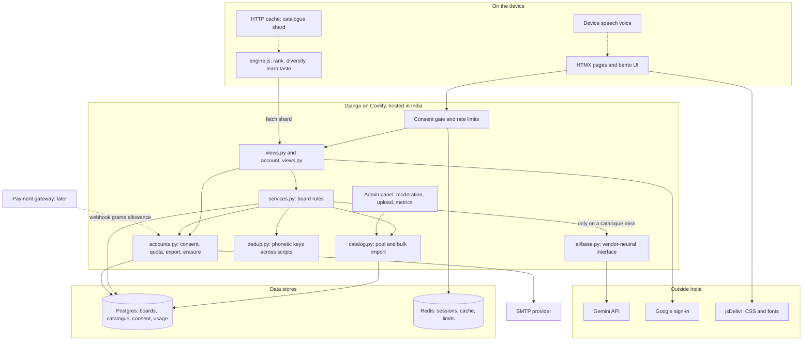
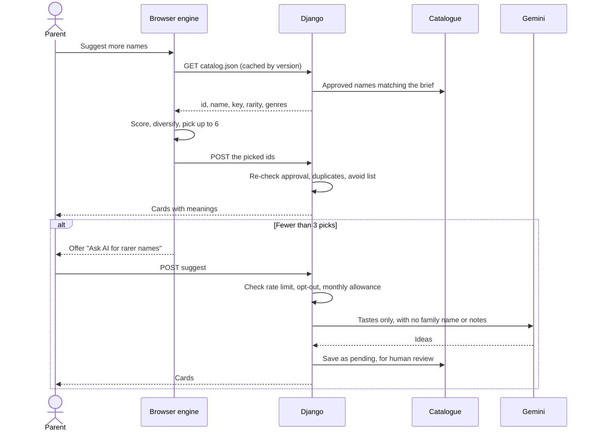

# Architecture

A server-rendered Django monolith with HTMX. The browser ranks names. The server owns state, permissions and money. The LLM is the last resort.

## How a suggestion gets made

## Where each thing runs

| Concern | Runs on | Why |
|---|---|---|
| Ranking, diversity, taste | Device | Free and instant, and a wrong answer costs nothing |
| Pronunciation | Device first | Free. The paid voice is a fallback, cached once per name for everyone |
| Catalogue filtering | Server | Limits how much of the catalogue one person can download |
| Duplicate checks on writes | Server | The one implementation handles Indian scripts, and a client can't be trusted to enforce it |
| Permissions, quotas, consent, payment state | Server | Anything on a device can be edited by its owner |
| Family boards | Server | Several people share them |

## Cost guards on the LLM

1. The catalogue and browser answer first.
2. People choose to spend a request, except when a new board has no matches at all.
3. Answers are cached by phonetic key, so a name is only described or voiced once across all families.
4. Paid answers join the moderation queue and can serve other families for free once approved.
5. A monthly allowance per parent, plus limits per board and overall.
6. Family ideas call the LLM at most once per version of a brief, however many relatives open the link.

## What the LLM sees

`names/ai/context.py` is the only gate. The rule: send what improves the names, never what only identifies people.

| Data | Sent? | Why |
|---|---|---|
| Preferences, names kept, passed and suggested by family | Yes | The signal the model needs, with no identity attached |
| The parents' description of what the name should mean | Yes, scrubbed of contact details and long numbers | The strongest signal available, and disclosed at the point of entry |
| Family name | Only if a parent ticks the box | Improves sound fit, but can suggest community |
| Email, account IDs, who voted or suggested | Never | Adds nothing to the answer |
| Nickname, photo, "names to avoid" | Never | Adds little, and may concern a child or a named relative. Avoided names are filtered on our side |

Descriptions and family names never reach the shared catalogue. `describe` calls send only the name, so their answers are safe to reuse across families.

## How decisions work

Each parent swipes privately. `Name.settle()` turns those swipes into a status:

| Parent A | Parent B | Result |
|---|---|---|
| Keep | Keep | Shortlist, "You both love this" |
| Keep | Not yet | On A's shortlist, in B's deck |
| Keep | Pass | Shortlist for both as "Talk about this one", hidden from family |
| Pass | Not yet | In B's deck |
| Pass | Pass | Bin, and can be brought back |

A solo parent's pass bins a name, but if a partner joins later, that name returns for them to decide.

## Adding payments

`accounts.ai_calls_left()` is the only place that decides what someone may use. To add a gateway: add an `Entitlement` or credit ledger table, a webhook view that verifies signatures and is idempotent, and read the ledger in that function. Add a refund policy page and a new `POLICY_VERSION` at the same time.
